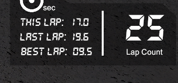

# Wall Follower Submission

| | |
|---|---|
| **Video (unlisted YouTube)** | [youtube.com/watch?v=mB_asxr3uaQ](https://www.youtube.com/watch?v=mB_asxr3uaQ) |
| **Fastest lap (in the video)** | 13.5 s |
| **Fastest lap (observed, not recorded)** | 9.5 s, reached later in a longer run that was not captured on video |

Simulator HUD after that longer run (25 laps, best lap 9.5 s):



The wall follower is a ROS 2 node at [`autodrive_devkit/autodrive_roboracer/wall_follow_node.py`](autodrive_devkit/autodrive_roboracer/wall_follow_node.py), registered in `setup.py` as `wall_follow_node`.

## How it works

1. **Wall geometry from two beams.** On each side a beam at ±90° (`b`) and one swept `theta` (50°) toward the front (`a`) give the wall angle `alpha = atan2(a·cosθ − b, a·sinθ)`, the perpendicular distance `D = b·cosα`, and the distance projected one lookahead `L` ahead, `D' = D + L·sinα`. Small windows of beams are averaged, and `inf`/`nan` returns are replaced by `range_max`.
2. **PD steering on the wall error.** `mode=center` (default) drives on `error = ½(D'_left − D'_right)`; `mode=left` / `mode=right` hold `desired_distance` from one wall. A positive error means "steer left", matching the simulator's convention (+1 = full left ≈ 0.52 rad). The steering command is lightly low-pass filtered.
3. **Corner anticipation.** The 90° beams cannot see a corner coming, so a second term compares how open the front-left and front-right sectors are (mean range over 20°–70° each side, clipped to `sector_clip`) and adds `kf · (open_left − open_right)` to the steering angle. On a straight both sectors are symmetric and the term is zero; approaching a turn the inside sector opens up and the car starts turning before the nose reaches the outer wall.
4. **Throttle scheduling.** Forward clearance only counts beams whose hit point is inside the car's path (`|r·sin a| ≤ path_half_width`), so corridor walls do not slow the car. Throttle interpolates between `throttle_min` and `throttle_max` using the smaller of the clearance fraction and `(1 − |steer|)²`.
5. **Safety.** Below `brake_distance` ahead the car brakes hard and steers full lock toward the more open forward sector. A 0.1 s watchdog publishes zero throttle if the LiDAR stream goes stale.

## Run

In the container, after `colcon build && source install/setup.bash` and with the bridge running:

```bash
ros2 run autodrive_roboracer wall_follow_node
```

Tune from the command line without rebuilding, e.g.:

```bash
ros2 run autodrive_roboracer wall_follow_node --ros-args \
  -p mode:=center -p kp:=1.0 -p kd:=0.1 -p kf:=0.6 -p lookahead:=0.6 \
  -p throttle_max:=0.55 -p throttle_min:=0.2 -p clear_far:=5.0 -p clear_near:=1.2
```

| Parameter | Default | Meaning |
|---|---|---|
| `mode` | `center` | `center`, `left`, or `right` |
| `desired_distance` | `0.8` | target gap to the followed wall (left/right modes) [m] |
| `lookahead` | `0.6` | projection distance ahead of the car [m] |
| `theta_deg` | `30` | offset of the second beam from the 90° beam |
| `kp`, `kd` | `1.0`, `0.10` | PD gains on the wall error (rad per m) |
| `kf` | `0.6` | gain on the front-sector openness difference (rad per m) |
| `sector_lo_deg`, `sector_hi_deg`, `sector_clip` | `20`, `70`, `2.5` | forward sectors used for corner anticipation |
| `steer_smoothing` | `0.3` | low-pass factor on the steering command |
| `debug_period` | `1.0` | telemetry log period [s], `0` to disable |
| `throttle_max`, `throttle_min` | `0.55`, `0.2` | throttle on open straights / in tight spots |
| `clear_far`, `clear_near` | `5.0`, `1.2` | clearance range mapped onto throttle [m] |
| `brake_distance` | `0.6` | emergency manoeuvre threshold ahead [m] |
| `front_cone_deg`, `path_half_width` | `45`, `0.35` | search cone and path width for forward clearance |

Lap count, best lap, and collision count from the simulator are logged by the node as they change.

---

# AutoDRIVE-RoboRacer Sim-Racing


RoboRacer Digital Twin Autonomous Sim-Racing League using AutoDRIVE Ecosystem

> [!NOTE]
> - The setup has been only tested on the [Ubuntu](https://ubuntu.com) operating system.
> - It is assumed that [Docker](https://docs.docker.com/engine/install) is installed.
> - It is assumed that if the Docker container is to take advantage of an NVIDIA GPU, the host machine has been properly configured by installing the necessary NVIDIA GPU drivers and the [NVIDIA Container Toolkit](https://docs.nvidia.com/datacenter/cloud-native/container-toolkit/latest/index.html).

## AutoDRIVE Simulator Container

> [!NOTE]
> The simulator executable must be placed inside [`/autodrive_simulator`](/autodrive_simulator) directory. This repository ships with an examplar working simulator executable, which can be updated as necessary.

### Build:

```bash
docker build --tag autodriveecosystem/autodrive_roboracer_sim:<TAG> -f autodrive_simulator.Dockerfile .
```

### Run:

```bash
xhost local:root
docker run --name autodrive_roboracer_sim --rm -it --entrypoint /bin/bash --network=host --ipc=host -v /tmp/.X11-unix:/tmp/.X11-unix:rw --env DISPLAY --privileged --gpus all autodriveecosystem/autodrive_roboracer_sim:<TAG>
```

### Push:

1. Run the image you created in the previous step inside a container:
```bash
xhost local:root
docker run --name autodrive_roboracer_sim --rm -it --entrypoint /bin/bash --network=host --ipc=host -v /tmp/.X11-unix:/tmp/.X11-unix:rw --env DISPLAY --privileged --gpus all autodriveecosystem/autodrive_roboracer_sim:<TAG>
```

2. In a new terminal window, list all containers and make a note of the desired `CONTAINER ID`:
```bash
docker ps -a
```

3. Commit changes to Docker Hub:
```bash
docker commit -m "AutoDRIVE-RoboRacer-Sim-Racing" -a "AutoDRIVE Ecosystem" <CONTAINER ID> autodriveecosystem/autodrive_roboracer_sim:<TAG>
```

4. Login to Docker Hub:
```bash
docker login
```

5. Push the container to Docker Hub, once done, you should be able to see your repository on Docker Hub:
```bash
docker push autodriveecosystem/autodrive_roboracer_sim:<TAG>
```

## AutoDRIVE Devkit Container

> [!NOTE]
> The devkit package(s) must be placed inside [`/autodrive_devkit`](/autodrive_devkit) directory. This repository ships with an examplar working devkit package, which can be updated as necessary.

### Build:

```bash
docker build --tag autodriveecosystem/autodrive_roboracer_api:<TAG> -f autodrive_devkit.Dockerfile .
```

### Run:

```bash
xhost local:root
docker run --name autodrive_roboracer_api --rm -it --entrypoint /bin/bash --network=host --ipc=host -v /tmp/.X11-unix:/tmp/.X11-unix:rw --env DISPLAY --privileged --gpus all autodriveecosystem/autodrive_roboracer_api:<TAG>
```

### Push:

1. Run the image you created in the previous step inside a container:
```bash
xhost local:root
docker run --name autodrive_roboracer_api --rm -it --entrypoint /bin/bash --network=host --ipc=host -v /tmp/.X11-unix:/tmp/.X11-unix:rw --env DISPLAY --privileged --gpus all autodriveecosystem/autodrive_roboracer_api:<TAG>
```

2. In a new terminal window, list all containers and make a note of the desired `CONTAINER ID`:
```bash
docker ps -a
```

3. Commit changes to Docker Hub:
```bash
docker commit -m "AutoDRIVE-RoboRacer-Sim-Racing" -a "AutoDRIVE Ecosystem" <CONTAINER ID> autodriveecosystem/autodrive_roboracer_api:<TAG>
```

4. Login to Docker Hub:
```bash
docker login
```

5. Push the container to Docker Hub, once done, you should be able to see your repository on Docker Hub:
```bash
docker push autodriveecosystem/autodrive_roboracer_api:<TAG>
```

## Competition Execution

1. Pull the team's image:
```bash
docker pull <TEAM_USERNAME>/<IMAGE_NAME>:<TAG>
```

2. Run the team's image you pulled in the previous step inside a container:
```bash
xhost local:root
docker run --name autodrive_roboracer_api --rm -it --entrypoint /bin/bash --network=host --ipc=host -v /tmp/.X11-unix:/tmp/.X11-unix:rw --env DISPLAY --privileged --gpus all <TEAM_USERNAME>/<IMAGE_NAME>:<TAG>
```

3. Run the simulator image inside a container, set graphics to `Ultra` quality and vehicle in `Autonomous` mode:
```bash
xhost local:root
docker run --name autodrive_roboracer_sim --rm -it --entrypoint /bin/bash --network=host --ipc=host -v /tmp/.X11-unix:/tmp/.X11-unix:rw --env DISPLAY --privileged --gpus all autodriveecosystem/autodrive_roboracer_sim:<TAG>
```

4. Begin screen recording (tested with [OBS Studio](https://obsproject.com)).

5. Execute a new bash session within the team's container, launch `rqtgraph` for inspection and start recording all data streams:
```bash
docker exec -it autodrive_roboracer_api bash
ros2 bag record -a -o qualification.bag
ros2 bag record -a -o competition.bag
rqtgraph
```

6. Enable the communication bridge between simulator and devkit to start the race.

7. After the race completion, kill the `rqtgraph`, data recording as well as screen recording processes, and copy the `rosgraph` and `rosbag` file to the host workstation:
```bash
docker cp autodrive_roboracer_api:/home/autodrive_devkit/qualification.bag /home/<USERNAME>
docker cp autodrive_roboracer_api:/home/autodrive_devkit/competition.bag /home/<USERNAME>
docker cp autodrive_roboracer_api:/home/autodrive_devkit/rosgraph.png /home/<USERNAME>
```

## Generally Helpful Docker Tips

1. To access the container while it is running, execute the following command in a new terminal window to start a new bash session inside the container:
```bash
docker exec -it <CONTAINER NAME> bash
```

2. To exit the bash session(s), simply execute:
```bash
exit
```

3. To kill the container, execute the following command:
```bash
docker kill <CONTAINER NAME>
```

4. To remove the container, simply execute:
```bash
docker rm <CONTAINER NAME>
```

5. Running or caching multiple docker images, containers, volumes, and networks can quickly consume a lot of disk space. Hence, it is always a good idea to frequently check Docker disk utilization:
```bash
docker system df
```

6. To avoid utilizing a lot of disk space, it is a good idea to frequently purge docker resources such as images, containers, volumes, and networks that are unused or dangling (i.e. not tagged or associated with a container). There are several ways with many options to achieve this, please refer to appropriate documentation. The easiest way (but a potentially dangerous one) is to use a single command to clean up all the docker resources (dangling or otherwise):
```bash
docker system prune -a
```

7. After Docker Desktop is installed, Docker CLI commands are by default forwarded to Docker Desktop instead of Docker Engine, and hence you cannot connect to the Docker daemon without running Docker Desktop. In order to avoid this, just switch to the `default` Docker context:
```bash
docker context ls
docker context use default
```
> [!NOTE]
> It is not recommended to use Docker Desktop on the Linux operating system. This is because Docker Desktop creates a virtual machine based on Linux, which is first of all not needed for native (host) Linux OS, and secondly, it sometimes does not expose the necessary access ports for the containers (e.g., trouble with GPU access).

## Citation

We encourage you to read and cite the following papers if you use any part of the competition framework for your research:

#### [AutoDRIVE: A Comprehensive, Flexible and Integrated Digital Twin Ecosystem for Enhancing Autonomous Driving Research and Education](https://arxiv.org/abs/2212.05241)
```bibtex
@article{AutoDRIVE-Ecosystem-2023,
author = {Samak, Tanmay and Samak, Chinmay and Kandhasamy, Sivanathan and Krovi, Venkat and Xie, Ming},
title = {AutoDRIVE: A Comprehensive, Flexible and Integrated Digital Twin Ecosystem for Autonomous Driving Research & Education},
journal = {Robotics},
volume = {12},
year = {2023},
number = {3},
article-number = {77},
url = {https://www.mdpi.com/2218-6581/12/3/77},
issn = {2218-6581},
doi = {10.3390/robotics12030077}
}
```
This work has been published in **MDPI Robotics.** The open-access publication can be found on [MDPI](https://doi.org/10.3390/robotics12030077).

#### [AutoDRIVE Simulator: A Simulator for Scaled Autonomous Vehicle Research and Education](https://arxiv.org/abs/2103.10030)
```bibtex
@inproceedings{AutoDRIVE-Simulator-2021,
author = {Samak, Tanmay Vilas and Samak, Chinmay Vilas and Xie, Ming},
title = {AutoDRIVE Simulator: A Simulator for Scaled Autonomous Vehicle Research and Education},
year = {2021},
isbn = {9781450390453},
publisher = {Association for Computing Machinery},
address = {New York, NY, USA},
url = {https://doi.org/10.1145/3483845.3483846},
doi = {10.1145/3483845.3483846},
booktitle = {2021 2nd International Conference on Control, Robotics and Intelligent System},
pages = {1–5},
numpages = {5},
location = {Qingdao, China},
series = {CCRIS'21}
}
```
This work has been published at **2021 International Conference on Control, Robotics and Intelligent System (CCRIS).** The publication can be found on [ACM Digital Library](https://dl.acm.org/doi/abs/10.1145/3483845.3483846).
